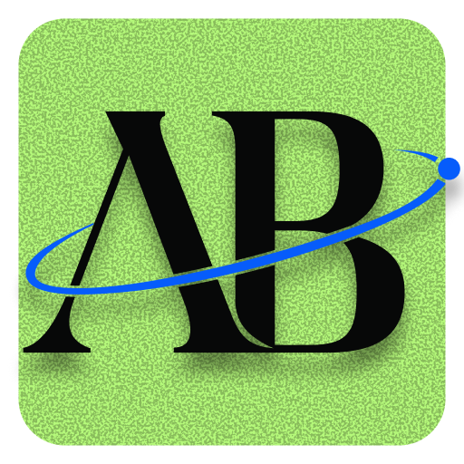

<p align="center"></p>

# AB-McHZ

Controle das telas do Mac pela barra de menus: brilho do monitor por DDC, resolução e taxa com reversão automática, diagnóstico e reparo de EDID, presets por monitor. Feito e medido num Mac mini M4 (macOS 27) com BenQ XL2430T e ASUS PG259QN.

**Uso pessoal e não comercial.** Licença [PolyForm Noncommercial 1.0.0](LICENSE.md): o código é aberto para ler, estudar, modificar e usar sem fins comerciais. Uso comercial precisa de autorização do autor.

## Edições

| | Livre | PRO |
|---|---|---|
| Brilho e contraste por DDC | ✓ | ✓ |
| Resolução e taxa com watchdog de 6 s | ✓ | ✓ |
| Diagnóstico e reparo de EDID com cabeçalho corrompido | ✓ | ✓ |
| `hetzctl` (leitura, modos, VCP) | ✓ | ✓ |
| Presets por monitor (`profiles/*.json`) | | ✓ |
| Otimização automática por monitor: ao conectar ou acordar, taxa máxima do perfil (PG259QN 360 Hz → 240 Hz; XL2430T 144 Hz na DP, 60 Hz na HDMI), perfil de cor sRGB e preset padrão uma vez por conexão | | ✓ |
| Próximos: telas virtuais, proteção de configuração, EDID override por arquivo, sincronia de brilho | | ✓ |

O PRO vem com **14 dias de avaliação** a partir do primeiro uso. Depois disso, ative com uma chave de licença:

```bash
hetzctl license activate ABMCHZ-PRO.…
hetzctl optimize benq --dry-run   # mostra o que a otimização faria
```

ou pelo menu **Ativar AB-McHZ PRO…**. A chave é verificada offline (assinatura Ed25519), sem conta nem internet.

## Instalar

Requer macOS 14+ e Xcode 16+ (Swift 6).

```bash
scripts/install.sh
```

Compila, instala `~/Applications/AB-McHZ.app` com o ícone AB e abre no login por um LaunchAgent. Para remover: `scripts/uninstall.sh`.

CLI:

```bash
swift build -c release && .build/release/hetzctl list
```

## Estrutura

- `Sources/HetzCore`: motor (DDC/MCCS por `IOAVService`, EDID por I2C, modos com watchdog, perfis, licença).
- `Sources/hetzctl`: CLI.
- `Sources/ABMcHZApp`: app da barra de menus.
- `profiles/`: perfis medidos por monitor.
- `docs/`: arquitetura, perfis e o que falta para o produto.

## Origem e créditos

Implementação própria sobre APIs da Apple e medição direta do hardware. Nenhum código, texto ou recurso de apps comerciais de terceiros. Projetos MIT usados como referência são creditados no arquivo onde a referência aparece.
